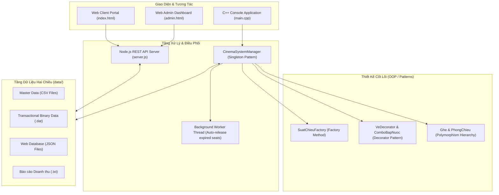

# HỆ THỐNG QUẢN LÝ RẠP CHIẾU PHIM (CINEMA MANAGEMENT SYSTEM)

[](https://isocpp.org/)
[](https://nodejs.org/)
[](server.js)
[](#️-kiến-trúc-hệ-thống--design-patterns)
[](LICENSE)

Hệ thống quản lý, điều phối vận hành rạp chiếu phim và bán vé đa nền tảng toàn diện. Giải pháp tích hợp sức mạnh tính toán và xử lý nghiệp vụ của **Core Engine C++17** (lập trình hướng đối tượng, thiết kế mẫu chuẩn mực, xử lý đa luồng, lưu trữ nhị phân) cùng **Nền tảng Web hiện đại (Full-stack Web Portal)** thông qua tầng REST API Backend và cơ chế đồng bộ dữ liệu hai tầng (Dual-layer Interoperability).

---

## Mục lục

- [Giới thiệu tổng quan](#-giới-thiệu-tổng-quan)
- [Kiến trúc hệ thống & Design Patterns](#️-kiến-trúc-hệ-thống--design-patterns)
- [Cấu trúc thư mục dự án](#-cấu-trúc-thư-mục-dự-án)
- [Các tính năng chính](#-các-tính-năng-chính)
  - [1. Phân hệ Cổng Khách hàng (User Portal)](#1-phân-hệ-cổng-khách-hàng-user-portal)
  - [2. Phân hệ Cổng Quản trị (Admin Portal)](#2-phân-hệ-cổng-quản-trị-admin-portal)
  - [3. Phân hệ Core Engine C++ (Console CLI)](#3-phân-hệ-core-engine-c-console-cli)
- [Cơ chế đồng bộ dữ liệu đa nền tảng](#-cơ-chế-đồng-bộ-dữ-liệu-đa-nền-tảng)
- [Hướng dẫn cài đặt & Khởi chạy](#-hướng-dẫn-cài-đặt--khởi-chạy)
  - [1. Yêu cầu môi trường](#1-yêu-cầu-môi-trường)
  - [2. Khởi chạy Ứng dụng Web & REST API](#2-khởi-chạy-ứng-dụng-web--rest-api)
  - [3. Biên dịch & Chạy Core Engine C++](#3-biên-dịch--chạy-core-engine-c)
  - [4. Chạy bộ kiểm thử tự động (Automated Testing)](#4-chạy-bộ-kiểm-thử-tự-động-automated-testing)
- [Cấu hình & Bảo mật](#-cấu-hình--bảo-mật)
- [Bản quyền & Giấy phép](#-bản-quyền--giấy-phép)

---

## Giới thiệu tổng quan

Hệ thống Quản lý Rạp chiếu phim được thiết kế theo kiến trúc module hóa cao, giải quyết trọn vẹn bài toán vận hành của các cụm rạp chiếu phim thương mại hiện đại:
- **Đa dạng phòng chiếu & định dạng:** Hỗ trợ chuẩn phòng 2D Standard, 3D RealD và IMAX Laser với mức phụ thu và quy cách bố trí linh hoạt.
- **Phân loại ghế & sơ đồ trực quan:** Ghế Thường, Ghế VIP, Ghế đôi Sweetbox với ma trận trạng thái ghế thời gian thực.
- **Cơ chế giữ chỗ đồng thời (Seat-hold Concurrency):** Khóa ghế tạm thời trong 5 phút (300 giây) kèm luồng chạy nền (background worker thread) tự động quét và giải phóng ghế quá hạn.
- **Tính giá vé động & Decorator Pattern:** Tự động kết hợp giá gốc phim, phụ thu phòng chiếu, phụ thu loại ghế, combo ẩm thực đính kèm và chiết khấu thành viên.
- **Đồng bộ dữ liệu hai tầng (Dual-layer Interoperability):** Dữ liệu được đồng bộ song song giữa Cấu trúc nhị phân (.dat) / CSV của C++ Engine và cơ sở dữ liệu JSON của Web REST API.

---

## Kiến trúc hệ thống & Design Patterns

Hệ thống áp dụng các nguyên lý **SOLID**, tính đóng gói, kế thừa, đa hình và các mẫu thiết kế kinh điển:



### 1. Decorator Pattern (Mở rộng hóa đơn vé động)
- **Component trừu tượng:** `VeXemPhim` định nghĩa hợp đồng chung (`tinhTien()`, `xuatThongTin()`, các getter/setter).
- **Concrete Component:** `VeCoBan` chứa thông tin suất chiếu và ghế ngồi, tính giá cơ bản theo công thức: Giá phim + Phụ thu phòng + Phụ thu ghế.
- **Base Decorator:** `VeDecorator` bọc đối tượng `VeXemPhim` và chuyển tiếp các lời gọi hàm.
- **Concrete Decorator:** `ComboBapNuoc` cho phép lồng ghép nhiều gói dịch vụ ẩm thực vào vé tại thời điểm chạy (runtime) mà không làm biến đổi cấu trúc cốt lõi của lớp vé gốc.

### 2. Factory Method Pattern (Khởi tạo sơ đồ phòng chiếu)
- **Creator trừu tượng:** `SuatChieuFactory` cung cấp phương thức thuần ảo `taoMaTranGhe(const PhongChieu& phong)`.
- **Concrete Creators:**
  - `Suat2DFactory`: Thiết lập phòng chiếu chuẩn với đa số ghế thường và hàng cuối là ghế đôi Sweetbox.
  - `Suat3DFactory`: Bố trí khu vực ghế VIP ở các hàng trung tâm (từ 40% đến 70% số hàng).
  - `SuatIMAXFactory`: Mở rộng khu vực ghế VIP lên tầm quan sát tối ưu (từ 30% đến 80% số hàng) phù hợp chuẩn màn hình cong IMAX.

### 3. Singleton Pattern (Quản trị viên điều phối trung tâm)
- `CinemaSystemManager` quản lý duy nhất toàn bộ luồng nghiệp vụ: lưu trữ danh mục dữ liệu, tìm kiếm suất chiếu, điều phối tiến trình đặt vé, phát hiện xung đột lịch chiếu, kết xuất báo cáo và bảo đảm tính toàn vẹn dữ liệu.

### 4. Tính Kế thừa & Đa hình (Inheritance & Polymorphism)
- **Hệ thống phòng chiếu:** Lớp cơ sở trừu tượng `PhongChieu` cùng các lớp con `Phong2D`, `Phong3D`, `PhongIMAX` định nghĩa mức phụ thu và đặc tính kỹ thuật tương ứng.
- **Hệ thống ghế ngồi:** Lớp cơ sở trừu tượng `Ghe` cùng các lớp con `GheThuong`, `GheVIP`, `GheDoiSweetbox` định hình quy tắc phụ thu và ký hiệu hiển thị riêng biệt.

### 5. Đa luồng & An toàn đồng thời (Concurrency & Thread Safety)
- Mỗi đối tượng `SuatChieu` sở hữu một background thread (`std::thread`, `std::mutex`, `std::condition_variable`) tự động thức dậy định kỳ để giải phóng các ghế giữ chỗ đã hết hạn 5 phút (`THOI_GIAN_GIU = 300s`) mà không phong tỏa luồng tương tác chính của ứng dụng.
- Cơ chế hủy luồng an toàn được cài đặt chặt chẽ trong destructor (`~SuatChieu`) bằng `condition_variable::notify_all()` và `join()`.

### 6. Xử lý ngoại lệ chuẩn mực (Exception Handling)
- Xây dựng cây phân cấp ngoại lệ kế thừa từ `std::runtime_error`:
  - `CinemaException`: Lớp cơ sở cho toàn bộ ngoại lệ nghiệp vụ rạp chiếu.
  - `SeatUnavailableException`: Ném ra khi ghế đã được giữ chỗ hoặc đã thanh toán.
  - `ScheduleConflictException`: Ném ra khi lịch chiếu mới bị trùng phòng và khoảng thời gian với suất chiếu sẵn có.

---

## Cấu trúc thư mục dự án

```text
Cinema-Management/
├── package.json                   # Cấu hình dự án, scripts khởi chạy và siêu dữ liệu
├── server.js                      # Backend REST API Server & HTTP Static File Server (Node.js)
├── run_web.bat                    # Script khởi động nhanh hệ thống Web trên Windows
├── main.cpp                       # Điểm khởi chạy ứng dụng C++ Console tương tác
├── LICENSE                        # Giấy phép phát hành phần mềm (ISC License)
│
├── index.html                     # Giao diện Cổng Khách hàng (User Portal)
├── admin.html                     # Giao diện Bảng điều khiển Quản trị viên (Admin Portal)
│
├── css/                           # Bảng định kiểu giao diện Web
│   ├── style.css                  # Giao diện người dùng: Carousel, Booking Flow, E-Ticket
│   └── admin.css                  # Giao diện quản trị: Dashboard KPI, Quản lý Rạp & Phim
│
├── js/                            # Mã nguồn xử lý phía Client
│   ├── app.js                     # Xử lý quy trình đặt vé, giỏ hàng, đếm ngược giữ ghế, tài khoản
│   ├── admin.js                   # Xử lý Dashboard thống kê, lịch chiếu, giám sát ghế, CRUD phim
│   ├── data.js                    # Dữ liệu gốc khởi tạo hệ thống (seed data)
│   └── storage.js                 # Tầng giao tiếp Client API & lưu trữ cục bộ
│
├── include/                       # Khai báo các lớp C++ Header (.h)
│   ├── Phim.h                     # Lớp quản lý thông tin phim (thời lượng, giá gốc, nhãn tuổi)
│   ├── PhongChieu.h               # Lớp trừu tượng PhongChieu & các lớp con (Phong2D, 3D, IMAX)
│   ├── Ghe.h                      # Lớp trừu tượng Ghe & các lớp con (GheThuong, VIP, Sweetbox)
│   ├── RapChieu.h                 # Quản lý cụm rạp và danh sách phòng chiếu trực thuộc
│   ├── SuatChieu.h                # Quản lý suất chiếu, ma trận ghế & luồng hủy ghế quá hạn
│   ├── SuatChieuFactory.h         # Factory Method: Khởi tạo ma trận ghế theo loại phòng
│   ├── VeXemPhim.h                # Giao diện Component gốc & Concrete Component VeCoBan
│   ├── VeDecorator.h              # Decorator cơ sở phục vụ mở rộng vé
│   ├── ComboBapNuoc.h             # Concrete Decorator: Tích hợp combo ẩm thực vào hóa đơn
│   ├── CinemaSystemManager.h      # Singleton: Điều phối nghiệp vụ và dữ liệu hệ thống
│   ├── TimeUtils.h                # Tiện ích thời gian & kiểm tra xung đột lịch chiếu
│   └── FileHandler.h              # Đọc/ghi CSV và Serialize dữ liệu nhị phân (.dat)
│
├── src/                           # Triển khai mã nguồn C++ (.cpp)
│   ├── Phim.cpp
│   ├── PhongChieu.cpp
│   ├── Ghe.cpp
│   ├── RapChieu.cpp
│   ├── SuatChieu.cpp
│   ├── SuatChieuFactory.cpp
│   ├── VeXemPhim.cpp
│   ├── VeDecorator.cpp
│   ├── ComboBapNuoc.cpp
│   ├── CinemaSystemManager.cpp
│   ├── TimeUtils.cpp
│   └── FileHandler.cpp
│
├── data/                          # Kho lưu trữ dữ liệu đồng bộ hai chiều
│   ├── ds_phim.csv / .json        # Danh mục phim (Mã, Tên, Thể loại, Thời lượng, Giá gốc, Rating...)
│   ├── ds_rap.csv / .json         # Danh mục cụm rạp & phòng chiếu
│   ├── bang_gia.csv / .json       # Bảng giá niêm yết combo bắp nước & phụ thu định dạng
│   ├── ds_suat_chieu.json         # Danh sách suất chiếu & trạng thái ma trận ghế thời gian thực
│   ├── ds_ve.json                 # Danh sách hóa đơn vé đã xuất
│   ├── nguoi_dung.csv / .json     # Hồ sơ khách hàng, điểm tích lũy & phân hạng thành viên
│   ├── trang_thai_ghe.dat         # Dữ liệu nhị phân C++: Trạng thái ghế (GheBinaryRecord - 48 bytes)
│   ├── ve_da_ban.dat              # Dữ liệu nhị phân C++: Hồ sơ vé bán (VeBinaryRecord - 376 bytes)
│   └── report_doanh_thu.txt       # Báo cáo doanh thu xuất khẩu từ hệ thống
│
└── tests/                         # Thư mục kiểm thử tự động
    ├── test_system.cpp            # Kiểm thử toàn diện Core C++ (OOP Patterns, Concurrency, Report)
    └── test_integration.js        # Kiểm thử tích hợp End-to-End REST API & Web Flows
```

---

## Các tính năng chính

### 1. Phân hệ Cổng Khách hàng (User Portal)
- **Danh mục phim & Video Trailer:** Xem danh sách phim đang chiếu và sắp chiếu kèm nhãn phân loại độ tuổi (**P**, **T13**, **T16**, **T18**), điểm đánh giá và video trailer YouTube nhúng trực tiếp.
- **Thanh đặt vé nhanh (Quick Booking):** Lọc theo thứ tự Phim $\rightarrow$ Cụm Rạp $\rightarrow$ Ngày Chiếu $\rightarrow$ Suất Chiếu.
- **Quy trình đặt vé 5 bước tiêu chuẩn:**
  1. *Chọn Suất chiếu:* Lựa chọn định dạng phòng (2D Standard, 3D RealD, IMAX Laser).
  2. *Sơ đồ ghế động:* Hiển thị màn hình cong phát sáng cùng ma trận ghế Thường `[T]`, VIP `[V]` và Ghế đôi Sweetbox `[S]`.
  3. *Khóa ghế 5 phút (300s):* Đồng hồ đếm ngược kích hoạt ngay khi chọn ghế; tự động giải phóng ghế nếu quá hạn mà chưa hoàn tất đặt vé.
  4. *Đính kèm Combo Ẩm thực:* Lựa chọn linh hoạt các gói bắp nước theo nhu cầu.
  5. *Thanh toán & Vé điện tử (E-Ticket):* Bóc tách chi tiết giá vé, áp dụng chiết khấu hạng thành viên và xuất vé điện tử kèm mã QR.
- **Tài khoản & Phân hạng thành viên:**
  - **Standard:** Tích lũy 5% điểm thưởng trên tổng chi tiêu.
  - **VIP Gold:** Giảm 5% giá vé xem phim, tích lũy 7% điểm thưởng.
  - **Platinum:** Giảm 10% trên toàn bộ hóa đơn (vé + ẩm thực), tích lũy 10% điểm thưởng.
- **Tra cứu & Hủy vé trực tuyến:** Tra cứu hóa đơn vé theo mã vé hoặc số điện thoại, hỗ trợ hủy vé an toàn và tự động hoàn trả trạng thái ghế về TRỐNG (`AVAILABLE`).

### 2. Phân hệ Cổng Quản trị (Admin Portal)
- **Xác thực bảo mật:** Cổng xác thực riêng biệt qua API Backend, ngăn chặn mọi truy cập trái phép.
- **Dashboard KPI Doanh thu đa chiều:**
  - Thẻ chỉ số tổng quan: Tổng doanh thu, Tổng số vé bán ra, Doanh thu trung bình / vé, Nhóm phim dẫn đầu.
  - Biểu đồ và bảng phân tích trực quan: Phân tích **Theo Phim**, **Theo Phòng chiếu**, hoặc **Theo Suất chiếu** kèm thanh tỷ trọng doanh thu.
  - Hỗ trợ xuất dữ liệu ra tệp báo cáo văn bản chuẩn hóa (`report_doanh_thu.txt`).
- **Điều phối Lịch chiếu & Phát hiện xung đột:**
  - Tự động cộng thời lượng phim + 15 phút dọn dẹp vệ sinh phòng.
  - Thuật toán kiểm tra giao thoa thời gian trên cùng một phòng chiếu; tự động ngăn chặn và cảnh báo xung đột lịch.
- **Giám sát Ghế thời gian thực (Real-time Seat Monitor):**
  - Quan sát trạng thái ma trận ghế (Trống, Đang giữ chỗ, Đã bán) theo từng suất chiếu.
  - Cho phép người quản trị chủ động giải phóng ghế đang bị giữ chỗ nếu phát sinh sự cố.
- **Quản lý Phim & Cụm rạp:**
  - Thêm mới và cập nhật phim: Tên, Thể loại, Thời lượng, Giá gốc, Poster, Backdrop 16:9, Trailer YouTube và Điểm đánh giá.
  - Quản trị Cụm rạp: Thêm rạp mới, cấu hình phòng chiếu (loại phòng, số hàng, số cột).

### 3. Phân hệ Core Engine C++ (Console CLI)
- **Menu tương tác dòng lệnh:** Đầy đủ nghiệp vụ duyệt phim, chọn rạp, xem lịch chiếu, chọn ghế và xuất hóa đơn.
- **Ma trận ghế trực quan:** Hệ thống ký hiệu chuẩn:
  - `[T]`: Ghế Thường (phụ thu 0đ).
  - `[V]`: Ghế VIP (phụ thu theo phòng).
  - `[S]`: Ghế đôi Sweetbox (phụ thu theo phòng, ghép cặp liền kề).
  - `[G]`: Ghế đang được giữ chỗ tạm thời (Pending - 300s).
  - `[B]`: Ghế đã bán thành công (Sold).
- **Công thức tính tiền tổng quát:**
  $$\text{Tổng thanh toán} = \text{Giá gốc phim} + \text{Phụ thu phòng} + \text{Phụ thu loại ghế} + \sum \text{Tiền combo} - \text{Chiết khấu thành viên}$$
- **Lưu trữ & Khôi phục nhị phân POD:** Lưu trữ cấu trúc nhị phân tối ưu hóa I/O cho trạng thái ghế và dữ liệu giao dịch vé.

---

## Cơ chế đồng bộ dữ liệu đa nền tảng

Hệ thống thiết lập cầu nối dữ liệu toàn vẹn giữa môi trường Web và Ứng dụng C++:

| Phân loại dữ liệu | Định dạng Web (JSON) | Định dạng C++ (CSV / Binary / TXT) | Mục đích sử dụng |
|:---|:---|:---|:---|
| **Danh mục Phim** | `data/ds_phim.json` | `data/ds_phim.csv` | Đồng bộ tên, thể loại, thời lượng, giá vé gốc, rating |
| **Cụm rạp & Phòng chiếu** | `data/ds_rap.json` | `data/ds_rap.csv` | Đồng bộ danh sách rạp, số phòng chiếu và cấu hình ma trận |
| **Bảng giá Combo** | `data/bang_gia_combo.json` | `data/bang_gia.csv` | Đồng bộ các gói combo bắp nước và giá niêm yết |
| **Trạng thái Ghế** | `data/ds_suat_chieu.json` | `data/trang_thai_ghe.dat` | Serialize nhị phân POD (`GheBinaryRecord` 48 bytes) |
| **Hồ sơ Vé đã bán** | `data/ds_ve.json` | `data/ve_da_ban.dat` | Serialize nhị phân POD (`VeBinaryRecord` 376 bytes) |
| **Báo cáo Doanh thu** | API `/api/reports/export-txt` | `data/report_doanh_thu.txt` | Xuất bảng biểu thống kê đa chiều theo chuẩn format C++ |

---

## Hướng dẫn cài đặt & Khởi chạy

### 1. Yêu cầu môi trường
- **Môi trường C++:** Trình biên dịch hỗ trợ **C++17** trở lên (`g++` / MinGW-w64, Clang hoặc MSVC).
- **Môi trường Web:** [Node.js](https://nodejs.org/) phiên bản 16.x trở lên.

---

### 2. Khởi chạy Ứng dụng Web & REST API

#### Cách 1: Khởi động nhanh (Khuyên dùng trên Windows)
Nhấp đúp chuột vào tệp [run_web.bat](run_web.bat) tại thư mục gốc của dự án. Hệ thống sẽ tự động khởi tạo dữ liệu mẫu (nếu chưa có), bật máy chủ backend và mở trình duyệt web.

#### Cách 2: Khởi động tiêu chuẩn qua dòng lệnh
```bash
# Khởi chạy Backend Server (sử dụng npm script)
npm start

# Hoặc khởi chạy trực tiếp với Node.js
node server.js
```

Sau khi khởi động, truy cập các cổng thông tin trên trình duyệt:
- **Cổng Khách hàng (User Portal):** `http://localhost:8088`
- **Cổng Quản trị (Admin Portal):** `http://localhost:8088/admin.html`

---

### 3. Biên dịch & Chạy Core Engine C++

#### Trên hệ điều hành Windows (MinGW / g++)
```powershell
# 1. Biên dịch toàn bộ mã nguồn C++
g++ -std=c++17 -Wall -Wextra -Iinclude main.cpp src/*.cpp -o cinema_app.exe

# 2. Thực thi chương trình
.\cinema_app.exe
```

#### Trên hệ điều hành Linux / macOS
```bash
# 1. Biên dịch
g++ -std=c++17 -Wall -Wextra -Iinclude main.cpp src/*.cpp -o cinema_app

# 2. Thực thi chương trình
./cinema_app
```

---

### 4. Chạy bộ kiểm thử tự động (Automated Testing)

Hệ thống được trang bị các bộ kiểm thử tự động độc lập nhằm xác minh tính toàn vẹn của cả Core Engine và Tầng Web:

```bash
# 1. Kiểm thử Tích hợp Web REST API & User Flows (Integration Test)
npm test

# 2. Kiểm thử Toàn diện Core C++ (OOP Patterns, Concurrency, Báo cáo)
npm run test:cpp

# Hoặc biên dịch và chạy trực tiếp bộ System Test C++:
# (Windows)
g++ -std=c++17 -Wall -Wextra -Iinclude tests/test_system.cpp src/*.cpp -o test_system.exe
.\test_system.exe

# (Linux / macOS)
g++ -std=c++17 -Wall -Wextra -Iinclude tests/test_system.cpp src/*.cpp -o test_system
./test_system
```

---

## Cấu hình & Bảo mật

- **Cấu hình Quản trị viên:** Thông tin cấu hình và thông tin xác thực quản trị được lưu trữ và bảo vệ độc quyền tại phía máy chủ Backend trong thư mục `data/`.
- **Ngăn chặn Truy cập Trực tiếp (HTTP 403 Forbidden):** Máy chủ Backend thiết lập cơ chế lọc yêu cầu tĩnh, từ chối mọi truy vấn HTTP trực tiếp từ trình duyệt đến các tệp cấu hình bảo mật hoặc dữ liệu nội bộ.
- **Xác thực Đăng nhập Quản trị:** Các tác vụ quản trị (quản lý lịch chiếu, chỉnh sửa danh mục phim, cấu hình phòng, hủy vé) yêu cầu xác thực phiên thông qua endpoint bảo mật `/api/auth/admin-login`.
- **Kiểm soát Tranh chấp Ghế (Concurrency Control):** Trạng thái giữ ghế tạm thời được khóa nguyên tử và kiểm soát đa luồng, loại bỏ nguy cơ trùng ghế (double-booking) khi nhiều phiên người dùng đặt vé cùng thời điểm.

---

## Bản quyền & Giấy phép

Dự án được phát hành theo giấy phép [ISC License](LICENSE).
